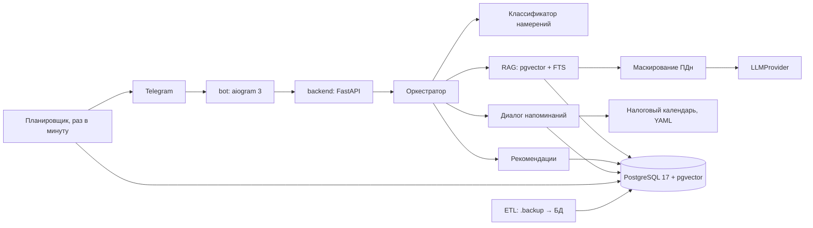

# Альфа-Наставник

ИИ-помощник для предпринимателей в Telegram. Хакатон Changellenge >> Hack&Change 2026, кейс Альфа-Банка «Альфа-Курс: знания в нужный момент», трек 2.

Бот отвечает на вопросы по базе знаний «Альфа-Курса», собирает сведения о бизнесе из диалога, рекомендует бесплатные и платные материалы и по просьбе пользователя напоминает об обучении и налоговых сроках.

## Возможности

- Ответы только по открытым материалам базы, с источниками. Если ответа нет, бот честно об этом говорит.
- Уточняющие вопросы кнопками на неоднозначные запросы.
- Профиль из диалога (стадия, сфера, форма бизнеса, налоговый режим, задача). Анкета необязательна, бот полезен с первого сообщения.
- Рекомендации 1–2 материалов с объяснением «почему». Платные материалы показываются только краткой пользой и ссылкой, не чаще одного раза на три ответа.
- Напоминания: разовые и повторяющиеся (день, неделя, месяц, квартал), обучение, налоговые сроки по режиму. Создаются только после подтверждения. Изменить частоту, отложить или отключить можно в `/reminders` или текстом («Сделай раз в две недели», «Отключи»).
- Антиспам: не больше одного сообщения в день по инициативе бота, тихие часы 22:00–09:00, отключение в одно нажатие.
- Источники нумеруются по порядку упоминания в ответе, ссылки показываются названием материала. Рекомендации не повторяют источники и учитывают стадию бизнеса: для работающего бизнеса не предлагаются материалы только для старта.
- Кнопка «⬅️ Назад» в ответах возвращает к предыдущему ответу (хранятся последние шесть).
- В напоминаниях показан часовой пояс со смещением от UTC; его можно сменить прямо при подтверждении.

## Архитектура



Сервисы в `compose.yaml`: `db` (PostgreSQL 17 + pgvector), `backend` (API, планировщик), `bot`, `etl` (разовая загрузка данных, профиль `etl`).

Планировщик каждую минуту выбирает из БД напоминания с наступившим `next_run_at`. Состояние хранится в БД, поэтому напоминания переживают перезапуск контейнера. Это замена APScheduler job store из ТЗ: используется APScheduler только как таймер.

## Быстрый запуск

Нужны Docker с Compose v2 и токен Telegram-бота.

```bash
cp env.example .env
```

В `.env` задайте `TELEGRAM_BOT_TOKEN`, пароли БД (`POSTGRES_PASSWORD` и тот же пароль в `DATABASE_URL`), `ID_HASH_SALT` и параметры LLM.

Положите выгрузку кейса в `data/raw/` (файл `alfa_course_hackathon.backup`), затем:

```bash
docker compose up --build -d db backend
docker compose --profile etl run --rm etl
docker compose up -d bot
```

Всё вместе одной командой: `docker compose up --build` (бот и бэкенд поднимутся, но без загрузки данных ответов не будет — шаг ETL нужен один раз).

Первая сборка и первый запуск скачивают модель эмбеддингов (около 1 ГБ), это занимает несколько минут.

## Входные данные

Выгрузка кейса — PostgreSQL-бэкап (`alfa_course_hackathon.backup`, формат архива 1.16, 62 таблицы). Файл кладётся в `data/raw/`. Эта папка исключена из git и из Docker-образов (`.gitignore`, `.dockerignore`), проверьте историю перед сдачей: `git log --stat -- data/raw`.

ETL (`etl/run.py`):

1. Восстанавливает бэкап во временную БД `alfa_source` (нужен `pg_restore` версии 17+, он есть в образе backend).
2. Берёт только опубликованные и не удалённые материалы: статьи, курсы, уроки, документы, вебинары, подкасты, глоссарий, калькуляторы.
3. Определяет платные материалы: курсы со стоимостью или тарифом, закрытые статьи и подкасты. Уроки платных курсов не загружаются вообще.
4. Для платных материалов в индекс идут только название и публичное описание. Полные тексты платных уроков в индекс не попадают (ограничение L6).
5. Делит тексты на чанки (около 220 слов, перекрытие 30), считает эмбеддинги `intfloat/multilingual-e5-base` локально.
6. Загружает журнал взаимодействий (старт и завершение курсов, уроки, оценки) для популярности и «после этого обычно изучают».

Ссылки на материалы строятся из `PLATFORM_BASE_URL` и шаблонов в `etl/mapping.py` (`URL_TEMPLATES`). Пути сверены с внутренними ссылками в текстах выгрузки: `/articles/`, `/vocabulary/` (словарь), `/courses/`, `/documents/`, `/podcasts/`, `/calculators/`, адрес заканчивается слешем. Для вебинаров подтверждений в выгрузке нет, поэтому ссылка на них не выдаётся, пока тип не добавлен в `LINKABLE_KINDS`.

## Переменные окружения

См. `env.example`. Основные:

| Переменная | Назначение |
|---|---|
| `TELEGRAM_BOT_TOKEN` | токен от @BotFather |
| `POSTGRES_USER`, `POSTGRES_PASSWORD`, `POSTGRES_DB`, `DATABASE_URL` | подключение к БД |
| `ID_HASH_SALT` | соль для хэша Telegram-ID |
| `LLM_PROVIDER` | `ollama`, `openai`, `gigachat`, `yandex` |
| `OLLAMA_BASE_URL`, `OLLAMA_MODEL` | локальная модель (по умолчанию `qwen2.5:7b`) |
| `OPENAI_BASE_URL`, `OPENAI_API_KEY`, `OPENAI_MODEL` | любой OpenAI-совместимый endpoint |
| `GIGACHAT_AUTH_KEY`, `GIGACHAT_SCOPE`, `GIGACHAT_MODEL` | GigaChat |
| `YANDEX_API_KEY`, `YANDEX_FOLDER_ID`, `YANDEX_MODEL` | YandexGPT |
| `RELEVANCE_THRESHOLD` | порог релевантности поиска (откалибровать, см. ниже) |
| `PLATFORM_BASE_URL` | адрес платформы для ссылок |
| `LINKABLE_KINDS` | типы материалов, для которых бот показывает ссылку (через запятую) |

Порты: `5433` (БД на хосте, внутри Docker `5432`, опубликован только на `127.0.0.1`), `8000` (API, опубликован только на `127.0.0.1`).

## Внешние API и приватность

- Telegram Bot API. Токен: @BotFather → `/newbot`.
- LLM по выбору. По умолчанию Ollama на вашей машине (`ollama pull qwen2.5:7b`, адрес `http://host.docker.internal:11434`), данные никуда не уходят. Для облачных провайдеров ключи берутся в их кабинетах (GigaChat Studio, Yandex Cloud) и задаются в `.env`.
- В LLM отправляются только: вопрос после маскирования ПДн (телефоны, e-mail, ИНН, номера карт, username, имя после «меня зовут»), фрагменты открытых материалов и обезличенные слоты профиля. Telegram-ID, имя и username в LLM не попадают. Маскирование стоит внутри обёртки провайдера, обойти его из кода сервисов нельзя.
- Эмбеддинги считаются локально.
- В БД хранится хэш Telegram-ID. Для отправки напоминаний нужен и `chat_id`, он хранится в таблице `users` и не покидает её. `/reset` удаляет пользователя, профиль, историю, напоминания и события.
- GigaChat подключается с отключённой проверкой сертификата (корневой сертификат Минцифры не входит в образ). Для продакшена добавьте сертификат в образ.

## Проверочные сценарии

1. **Вопрос по базе.** Напишите «Как выбрать налоговый режим для кофейни?» без `/start`. Ожидается ответ по базе с источниками, до двух рекомендаций (бесплатная и, если уместно, платная — краткая польза и ссылка), кнопки 👍 / 👎 / «Ещё по теме» / «Напомнить изучить» и один уточняющий вопрос про ИП или ООО. В `/profile` появятся сфера «общепит» и стадия «запуск».
2. **Напоминание.** Напишите «Напомни заплатить налог». Бот спросит режим и форму, предложит часовой пояс, покажет список напоминаний и спросит подтверждение. Затем: «Напоминай каждый вторник продолжить курс» → «Сделай раз в две недели» → «Отключи». Управление также доступно в `/reminders`.
3. **Неоднозначный вопрос и вопрос вне базы.** «Как платить меньше?» → уточнение кнопками. «Как получить визу в Китай?» → честный отказ с ближайшими темами. «Перескажи платный урок» → краткая польза курса и ссылка без содержания.

Чтобы быстро проверить сработавшее напоминание, создайте разовое: «Напомни завтра в 10:00 позвонить поставщику» и сдвиньте `next_run_at` в БД: `UPDATE reminders SET next_run_at = now() WHERE active;` (планировщик отработает в течение минуты, если сейчас не тихие часы).

## Тесты и оценка

```bash
pip install -r requirements.txt
cd backend && pytest
```

Тесты не требуют БД и LLM: маскирование ПДн, налоговый календарь, разбор расписаний, намерения, фильтры платного контента, рекомендатель, диалог напоминаний, API-схемы.

Оценка на данных (после ETL):

```bash
docker compose run --rm etl python -m eval.eval_rag
docker compose run --rm etl python -m eval.eval_recommender
docker compose run --rm etl python -m eval.eval_reminders
```

- `eval_rag` печатает точность источников по 40 вопросам, отсутствие утечек платного текста и таблицу порогов. По ней нужно выбрать `RELEVANCE_THRESHOLD`: значение по умолчанию (0.6) подобрано без доступа к данным.
- `eval_recommender` сравнивает рекомендатель с бейзлайном «совпадение по теме» и с популярностью по журналу выгрузки (Hit@5, NDCG@10).
- `eval_reminders` проверяет разбор 30 фраз и опорные даты налогового календаря.

Наборы вопросов лежат в `data/test/`. Ожидаемые источники в `rag_questions.json` заданы ключевыми словами в заголовках и темах; их стоит уточнить по реальному каталогу.

## Как бот возвращает пользователей на платформу и как это проверить

Механики: короткий ответ в чате и ссылка на материал для глубины; напоминания о продолжении обучения (только по согласию пользователя); налоговые напоминания с материалом по теме; следующий шаг после каждого ответа; платный курс предлагается в момент интереса и не чаще раза на три ответа.

Проверка после внедрения:

- **Дизайн:** A/B-тест, 4–6 недель, рандомизация по пользователю. Группа A получает только ответы, без рекомендаций и напоминаний (поле `users.ab_group`, в коде группа A уже обходит рекомендации; назначение групп при запуске теста нужно включить), группа B — полную версию.
- **Атрибуция:** все ссылки бота содержат `utm_source=tg_bot`, `utm_content=<rec|reminder|tax|src>`, `utm_campaign=<id материала>`, `utm_term=<хэш пользователя>`.
- **Основная метрика:** конверсия в покупку образовательного продукта за 30 дней. **Дополнительная:** число активных дней на платформе за 30 дней.
- **Предохранители:** доля отключивших напоминания, блокировки бота, доля 👎.
- **Промежуточные:** CTR рекомендаций, доля переходов из напоминаний, доля пользователей с активным напоминанием.
- **Статистика:** размер выборки под MDE, bootstrap-интервалы, CUPED по активности до эксперимента.
- **Логи:** таблица `events` хранит воронку (`start`, `answer_given`, `no_answer`, `reminder_created`, `reminder_sent`, `feedback_*` и другие) без текстов пользователей. Для вопросов без ответа сохраняется только маскированный текст.

## Известные ограничения

- Сборка через Docker и сквозной прогон (ETL, поиск, генерация, отправка напоминаний) в среде разработки не запускались: Docker там не был установлен. Логика без БД покрыта тестами, SQL-запросы поиска и ETL проверены только чтением и требуют первого прогона.
- Порог релевантности и веса рекомендатора не откалиброваны на реальных данных.
- Налоговые сроки в `data/tax_calendar.yaml` справочные: перед использованием сверьте их с календарём ФНС на нужный год. Сдвиг сроков учитывает выходные, но не праздники. Срок оплаты патента задаётся пользователем.
- Определение платных материалов основано на полях `Cost`, `CourseTariffBindings` и `IsClosed`. Проверьте на вашей выгрузке: в нашей платным оказался один курс из 37.
- Часовой пояс выбирается из четырёх вариантов, остальные пока не поддерживаются.
- Бот работает на long polling в одном экземпляре.
- Презентация (PDF) в репозиторий не входит.
