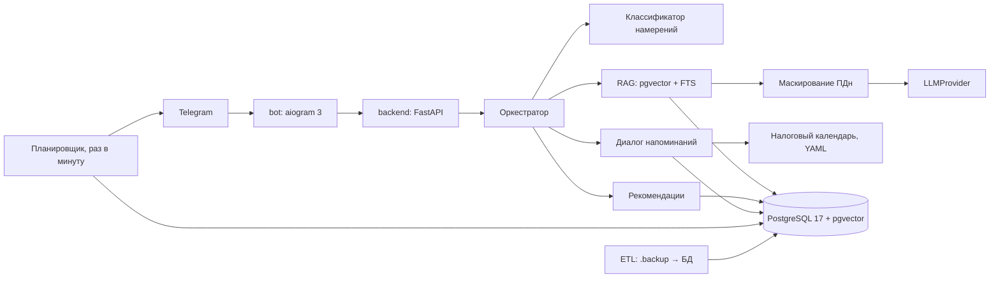

# Альфа-Наставник

ИИ-помощник для предпринимателей в Telegram. Хакатон Changellenge >> Hack&Change 2026, кейс Альфа-Банка «Альфа-Курс: знания в нужный момент», трек 2.

Бот отвечает на вопросы по базе знаний «Альфа-Курса», собирает сведения о бизнесе из диалога, подбирает бесплатные и платные материалы и по просьбе пользователя напоминает об обучении и налоговых сроках.

Бот не развёрнут на постоянном сервере: проверка идёт локальным запуском по инструкции ниже. Запуск целиком выполняется командами Docker, отдельно ставить Python и базу данных не нужно.

## Что умеет бот

- Отвечает только по открытым материалам базы и указывает источники. Если ответа в базе нет, честно об этом говорит и предлагает ближайшие материалы.
- Задаёт уточняющие вопросы кнопками, если запрос можно понять по-разному.
- Собирает профиль из диалога: стадия, сфера, форма бизнеса, налоговый режим, главная задача. Анкета необязательна, бот полезен с первого сообщения.
- Рекомендует 1–2 материала с объяснением «почему». Платные курсы показываются кратким описанием пользы и ссылкой, не чаще одного раза на три ответа, и никогда не пересказываются.
- Учитывает стадию бизнеса: для работающего бизнеса не предлагает материалы «для старта» и примеры про запуск.
- Источники нумеруются по порядку упоминания в ответе, ссылки показаны названием материала. Рекомендации не повторяют источники.
- Напоминания: разовые и повторяющиеся (день, неделя, месяц, квартал), напоминания об обучении и налоговые сроки по режиму. Создаются только после подтверждения. Показывают часовой пояс со смещением от UTC, пояс можно сменить при подтверждении. Частоту можно менять, откладывать и отключать в `/reminders` или текстом («Сделай раз в две недели», «Отключи»).
- Кнопка «⬅️ Назад» в ответах возвращает к предыдущим ответам (хранятся последние шесть).
- Антиспам: не больше одного сообщения в день по инициативе бота, тихие часы 22:00–09:00, отключение в одно нажатие.

Команды бота: `/start`, `/help`, `/profile`, `/reminders`, `/reset` (удаляет все данные пользователя).

## Архитектура



Сервисы в `compose.yaml`: `db` (PostgreSQL 17 + pgvector), `backend` (API и планировщик), `bot`, `etl` (разовая загрузка данных, профиль `etl`).

Планировщик каждую минуту выбирает из БД напоминания, у которых наступило время. Состояние хранится в БД, поэтому напоминания переживают перезапуск контейнеров.

## Запуск для проверки

### Что понадобится

- Docker Desktop (Windows, macOS) или Docker Engine с Compose v2 (Linux). Свободно около 10 ГБ на диске.
- Файл выгрузки кейса `alfa_course_hackathon.backup`.
- Токен Telegram-бота (шаг 1) и доступ к Telegram.
- Языковая модель: локальная через Ollama или облачная по ключу (шаг 4).

### Шаг 1. Создать тестового бота в Telegram

Бот нигде не развёрнут, поэтому для проверки запускается собственный экземпляр под вашим токеном. В Telegram откройте @BotFather, отправьте `/newbot`, задайте любое имя и адрес, оканчивающийся на `bot`. BotFather пришлёт токен вида `123456:ABC...`.

### Шаг 2. Положить данные

Скопируйте выгрузку в `data/raw/alfa_course_hackathon.backup`. Данные остаются на вашей машине: папка `data/raw/` не входит в репозиторий и не попадает в Docker-образы.

### Шаг 3. Настроить окружение

Скопируйте шаблон настроек.

```bash
cp env.example .env
```

В PowerShell: `Copy-Item env.example .env`.

В `.env` задайте:
- `TELEGRAM_BOT_TOKEN` — токен из шага 1;
- `POSTGRES_PASSWORD` и тот же пароль внутри `DATABASE_URL` (между `alfa:` и `@db`);
- `ID_HASH_SALT` — любая случайная строка.

### Шаг 4. Выбрать языковую модель

Бот работает с любым из четырёх вариантов. Выберите один.

**Вариант A. Локальная модель через Ollama (по умолчанию, данные никуда не уходят).** Протестировано на `gemma3:12b` (около 8 ГБ, рекомендуется видеокарта с 12 ГБ памяти, на процессоре будет медленнее).

1. Установите Ollama: https://ollama.com/download
2. Скачайте модель:

```bash
ollama pull gemma3:12b
```

Больше ничего менять не нужно: в `.env` уже стоят `LLM_PROVIDER=ollama`, `OLLAMA_MODEL=gemma3:12b` и `OLLAMA_BASE_URL=http://host.docker.internal:11434`. На Linux Ollama должна слушать не только localhost: запустите её с `OLLAMA_HOST=0.0.0.0`.

**Вариант B. Облачный провайдер по ключу.**

| Сервис | `LLM_PROVIDER` | Переменные в `.env` |
|---|---|---|
| Любой OpenAI-совместимый API (OpenAI, OpenRouter и другие) | `openai` | `OPENAI_BASE_URL`, `OPENAI_API_KEY`, `OPENAI_MODEL` |
| GigaChat | `gigachat` | `GIGACHAT_AUTH_KEY`, `GIGACHAT_SCOPE`, `GIGACHAT_MODEL` |
| YandexGPT | `yandex` | `YANDEX_API_KEY`, `YANDEX_FOLDER_ID`, `YANDEX_MODEL` |

Для GigaChat при необходимости укажите сертификат НУЦ Минцифры в `GIGACHAT_CA_BUNDLE`. Пример для OpenAI-совместимого сервиса:

```
LLM_PROVIDER=openai
OPENAI_BASE_URL=https://api.openai.com/v1
OPENAI_API_KEY=<ваш ключ>
OPENAI_MODEL=<название модели>
```

### Шаг 5. Запустить

```bash
docker compose up --build -d db backend
docker compose --profile etl run --rm etl
docker compose up -d bot
```

- Первая команда собирает образы и поднимает базу и бэкенд. Первая сборка занимает несколько минут.
- Вторая выполняет загрузку данных (ETL), один раз. При первом запуске скачивается модель эмбеддингов (около 1 ГБ), весь шаг занимает 10–15 минут на процессоре. В конце печатается строка вида `materials=1845 interactions=41076 chunks=6979` и `done`.
- Третья запускает бота.

### Шаг 6. Убедиться, что всё работает

```bash
docker compose ps
docker compose logs bot --tail 5
```

Все три сервиса должны быть в статусе `Up`, в логе бота строка `Run polling for bot @...`. Бэкенд отвечает на `http://127.0.0.1:8000/health` значением `{"status":"ok"}`.

Откройте своего бота в Telegram, нажмите `/start` и пройдите сценарии из следующего раздела. Первый ответ после запуска может занять до минуты: модель загружается в память, дальше ответы приходят за 5–10 секунд.

### Остановка

```bash
docker compose stop
```

Данные и напоминания сохраняются. Полностью удалить контейнеры и данные: `docker compose down -v`.

### Проверка без Telegram

Диалог можно проверить через HTTP API. Интерактивная документация открывается на `http://127.0.0.1:8000/docs`. Пример запроса:

```bash
curl -X POST http://127.0.0.1:8000/chat -H "Content-Type: application/json" \
  -d '{"tg_id": 1, "chat_id": 1, "text": "Как выбрать налоговый режим для кофейни?"}'
```

Если в `.env` задан `API_TOKEN`, добавьте заголовок `X-Api-Key: <значение>`. Поиск по базе: `GET /materials/search?q=налоговый режим`, статистика: `GET /stats`.

## Проверочные сценарии

1. **Вопрос по базе.** Напишите «Как выбрать налоговый режим для кофейни?». Ожидается ответ по базе с источниками, до двух рекомендаций (бесплатная и, если уместно, платная: краткая польза и ссылка), кнопки 👍 / 👎 / «Ещё по теме» / «Напомнить изучить» / «⬅️ Назад» и один уточняющий вопрос про ИП или ООО. В `/profile` появятся сфера «общепит» и стадия.
2. **Напоминание.** Напишите «Напомни заплатить налог». Бот спросит режим и форму, предложит часовой пояс, покажет черновик с часовым поясом и попросит подтверждение. Затем: «Напоминай каждый вторник продолжить курс» → «Сделай раз в две недели» → «Отключи». Управление также доступно в `/reminders`.
3. **Неоднозначный вопрос и вопрос вне базы.** «Как платить меньше?» → уточнение кнопками, после выбора бот отвечает. «Как получить визу в Китай?» → честный отказ с ближайшими темами. «Перескажи платный урок» → краткая польза курса и ссылка без содержания.
4. **Работающий бизнес.** В `/start` выберите «Бизнес работает» и задайте любой вопрос: в рекомендациях и примерах не будет материалов «для старта».

Чтобы быстро проверить сработавшее напоминание, создайте разовое («Напомни завтра в 10:00 позвонить поставщику») и сдвиньте время в БД:

```bash
docker compose exec db psql -U alfa -d alfa -c "UPDATE reminders SET next_run_at = now() WHERE active;"
```

Сообщение придёт в течение минуты, если сейчас не тихие часы (22:00–09:00 по часовому поясу пользователя).

## Входные данные

Выгрузка кейса — PostgreSQL-бэкап (`alfa_course_hackathon.backup`, 62 таблицы). ETL (`etl/run.py`) обрабатывает её так:

1. Восстанавливает бэкап во временную БД `alfa_source`.
2. Берёт только опубликованные и не удалённые материалы: статьи, курсы, уроки, документы, вебинары, подкасты, глоссарий, калькуляторы (всего 1845 материалов).
3. Определяет платные материалы: курсы со стоимостью или тарифом, закрытые статьи и подкасты. В выгрузке их немного: 4 статьи и 1 курс. Уроки платных курсов не загружаются вообще.
4. Для платных материалов в индекс попадают только название и публичное описание, полные тексты не попадают никогда.
5. Делит тексты на фрагменты (около 220 слов, перекрытие 30) и считает эмбеддинги `intfloat/multilingual-e5-base` локально (6979 фрагментов).
6. Загружает журнал взаимодействий (41 076 записей: старт и завершение курсов, уроки, оценки) для популярности и подсказок «после этого обычно изучают».

Ссылки строятся из адреса платформы `https://kurs.alfabank.ru` и типа материала: `/articles/`, `/vocabulary/` (словарь), `/courses/`, `/documents/`, `/podcasts/`, `/calculators/`, адрес заканчивается слешем. Пути проверены по внутренним ссылкам в текстах выгрузки. Для вебинаров такой информации в выгрузке нет, поэтому ссылка на них не выдаётся.

## Настройки

Все настройки лежат в `.env` (шаблон `env.example`). Основные:

| Переменная | Назначение |
|---|---|
| `TELEGRAM_BOT_TOKEN` | токен бота от @BotFather |
| `POSTGRES_USER`, `POSTGRES_PASSWORD`, `POSTGRES_DB`, `DATABASE_URL` | подключение к БД |
| `ID_HASH_SALT` | соль для хэша Telegram-ID |
| `API_TOKEN` | общий секрет между ботом и бэкендом (заголовок `X-Api-Key`); пусто — проверка выключена |
| `LLM_PROVIDER` | `ollama`, `openai`, `gigachat` или `yandex` |
| `OLLAMA_BASE_URL`, `OLLAMA_MODEL` | локальная модель (по умолчанию `gemma3:12b`) |
| `OPENAI_BASE_URL`, `OPENAI_API_KEY`, `OPENAI_MODEL` | OpenAI-совместимый API |
| `GIGACHAT_AUTH_KEY`, `GIGACHAT_SCOPE`, `GIGACHAT_MODEL` | GigaChat |
| `GIGACHAT_VERIFY_SSL`, `GIGACHAT_CA_BUNDLE` | проверка TLS GigaChat; для сертификата НУЦ Минцифры укажите путь к нему |
| `YANDEX_API_KEY`, `YANDEX_FOLDER_ID`, `YANDEX_MODEL` | YandexGPT |
| `RELEVANCE_THRESHOLD` | порог релевантности поиска (0.85, подобран оценкой ниже) |
| `PLATFORM_BASE_URL` | адрес платформы для ссылок |
| `LINKABLE_KINDS` | типы материалов, для которых бот показывает ссылку |

Порты на хосте: `5433` (БД) и `8000` (API), оба опубликованы только на `127.0.0.1`.

## Внешние API и приватность

- Telegram Bot API. Токен выдаёт @BotFather.
- Языковая модель по выбору: локальная Ollama (данные не покидают компьютер) или облачный провайдер. Название сервиса, модель и переменные ключа перечислены в шаге 4.
- В модель отправляются только: вопрос после маскирования персональных данных (телефоны, e-mail, ИНН, номера карт, username, имя после «меня зовут»), фрагменты открытых материалов и обезличенные слоты профиля. Telegram-ID, имя и username в модель не попадают. Маскируются вопрос пользователя и история диалога; фрагменты материалов остаются как есть, чтобы не искажать числа в них. Маскирование встроено в обёртку провайдера и не обходится из кода сервисов.
- Эмбеддинги считаются локально.
- В БД хранится хэш Telegram-ID. Для отправки напоминаний нужен и `chat_id`, он хранится в таблице `users` открытым текстом и не покидает БД. Команда `/reset` удаляет пользователя, профиль, историю, напоминания и события.

## Тесты и оценка качества

Автотесты не требуют ни БД, ни модели. Запуск внутри Docker:

```bash
docker compose run --rm --no-deps backend pytest -q --ignore=tests/test_bot_render.py
```

Тесты покрывают маскирование персональных данных, налоговый календарь, разбор расписаний, намерения, фильтры платного контента, рекомендатель, диалог напоминаний, навигацию, оформление ссылок и API-схемы. Тесты форматирования сообщений бота (`test_bot_render.py`) запускаются локально: `pip install -r requirements.txt && cd backend && pytest`.

Оценка на данных (после ETL):

```bash
docker compose run --rm etl python -m eval.eval_rag
docker compose run --rm etl python -m eval.eval_recommender
docker compose run --rm etl python -m eval.eval_reminders
```

Результаты нашего прогона:

| Проверка | Результат |
|---|---|
| Точность источников в топ-3 (40 вопросов) | 92% при цели не меньше 85% |
| Фрагменты платного контента сверх названия и описания | 0 |
| Разбор расписаний напоминаний (30 фраз) | 30 из 30 (100%) |
| Опорные даты налогового календаря | 5 из 5 |

Рекомендатель на 300 пользователях из журнала выгрузки:

| Модель | Hit@5 | NDCG@10 |
|---|---|---|
| Бейзлайн: совпадение по теме | 0.547 | 0.437 |
| Популярность | 0.587 | 0.453 |
| Наш рекомендатель | **0.837** | **0.685** |

Порог релевантности подбирался по тому же набору: 40 вопросов, на которые в базе есть ответ, и 10 вопросов вне базы.

| Порог | Отвечает на вопросы по базе | Отклоняет вопросы вне базы |
|---|---|---|
| 0.60 | 100% | 0% |
| 0.80 | 100% | 20% |
| **0.85 (выбран)** | **95%** | **80%** |
| 0.90 | 30% | 100% |

Наборы вопросов лежат в `data/test/`.

## Как бот возвращает пользователей на платформу и как это проверить

Механики: короткий ответ в чате и ссылка на материал для глубины; напоминания о продолжении обучения (только по согласию пользователя); налоговые напоминания с материалом по теме; следующий шаг после каждого ответа; платный курс предлагается в момент интереса и не чаще раза на три ответа.

План проверки эффекта после внедрения:

- **Дизайн:** A/B-тест 4–6 недель, рандомизация по пользователю. Группа A получает только ответы, без рекомендаций и напоминаний (признак `users.ab_group` уже поддержан в коде), группа B получает полную версию.
- **Атрибуция:** все ссылки бота содержат `utm_source=tg_bot`, `utm_content=<rec|reminder|tax|src>`, `utm_campaign=<id материала>`, `utm_term=<хэш пользователя>`.
- **Основная метрика:** конверсия в покупку образовательного продукта за 30 дней. **Дополнительная:** число активных дней на платформе за 30 дней.
- **Предохранители:** доля отключивших напоминания, блокировки бота, доля 👎.
- **Промежуточные:** CTR рекомендаций, доля переходов из напоминаний, доля пользователей с активным напоминанием.
- **Статистика:** размер выборки под минимальный обнаружимый эффект, bootstrap-интервалы, CUPED по активности до эксперимента. Базовые значения конверсии и активных дней принимаются как допущения.
- **Логи:** таблица `events` хранит воронку (`start`, `answer_given`, `no_answer`, `reminder_created`, `reminder_sent`, `feedback_*` и другие) без текстов пользователей. Для вопросов без ответа сохраняется только маскированный текст.

## Ограничения

- Бот работает на long polling в одном экземпляре; запуск второго экземпляра с тем же токеном нарушит работу первого.
- Налоговые сроки в `data/tax_calendar.yaml` справочные: перед использованием сверьте их с календарём ФНС на нужный год. Сдвиг сроков учитывает выходные, но не праздники. Срок оплаты патента задаёт пользователь.
- Часовой пояс выбирается из четырёх вариантов: Москва, Екатеринбург, Новосибирск, Владивосток.
- Качество ответов зависит от выбранной модели: небольшие локальные модели иногда отвечают неточно или не по теме, а при сбое модели бот показывает список подходящих материалов вместо ответа.
- Платных материалов в выгрузке мало, поэтому проверка показа платных рекомендаций ограничена одним курсом и четырьмя статьями.
- Оценка рекомендаций выполнена офлайн на журнале выгрузки; влияние на конверсию можно измерить только после внедрения по плану выше.
